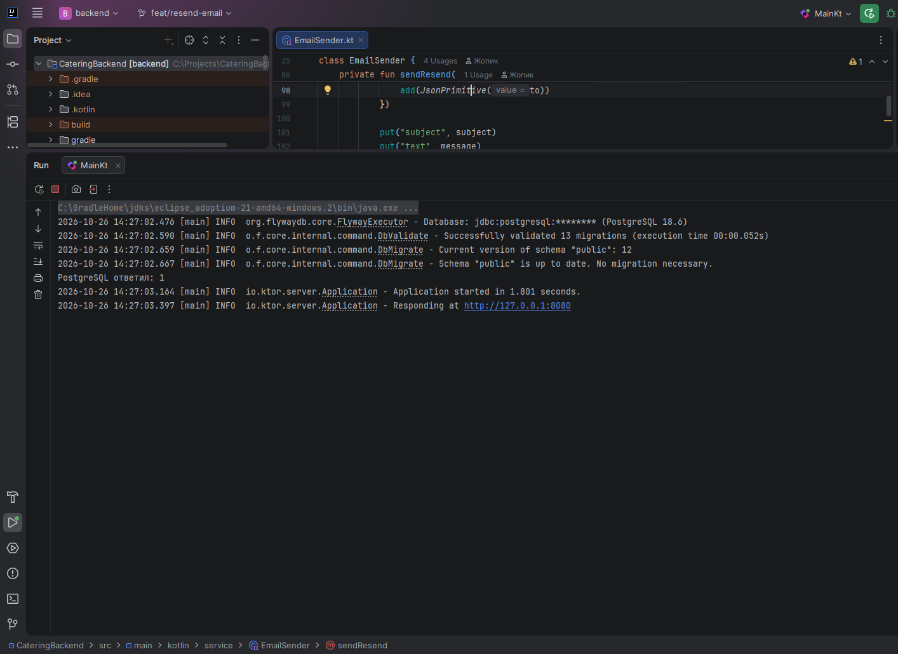
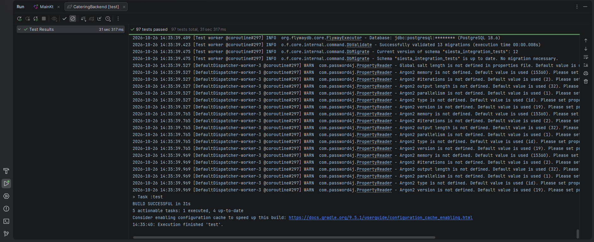
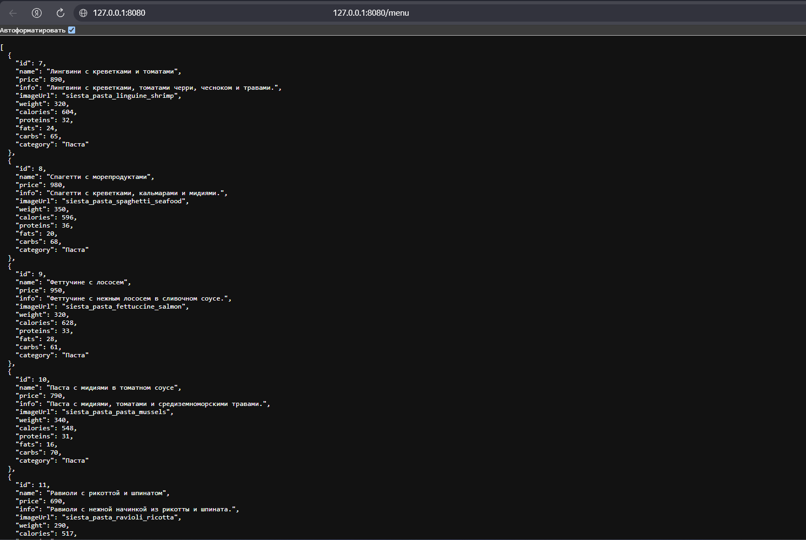
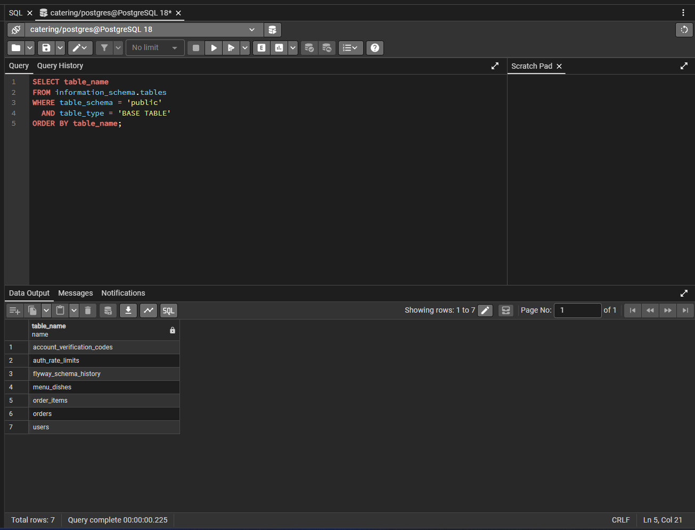

# CateringBackend — СИЕСТА / Food Hub

[](https://github.com/pavel7773/CateringBackend/actions/workflows/backend-ci.yml)

**Kotlin/Ktor REST API** для [Android-приложения FoodHub](https://github.com/pavel7773/FoodHub) на Jetpack Compose.

**Статус:** активная разработка и тестирование. Проект содержит серверную логику и доступ к PostgreSQL; README не означает завершённый публичный релиз.

## Возможности

- Каталог блюд: `GET /menu`.
- Регистрация, вход, профиль и управление паролем.
- JWT-аутентификация с проверкой версии сессии на сервере.
- Создание, просмотр и отмена заказов.
- Серверная проверка состава заказа, контактных данных и расчёта стоимости, включая промокоды.
- Идемпотентное создание заказов: ключ операции и уникальность пары «пользователь / ключ» в PostgreSQL.
- Подтверждение адреса электронной почты и восстановление доступа.
- Ограничение частоты отдельных запросов.

## Технологический стек

| Назначение | Технологии |
| --- | --- |
| Сервер | Kotlin, Ktor, Netty |
| API | REST, Kotlinx Serialization |
| Данные | PostgreSQL, Exposed JDBC |
| Миграции | Flyway |
| Авторизация | JWT, Argon2 (Password4j) |
| Почтовые уведомления | Resend API или SMTP (через конфигурацию окружения) |
| Тестирование | Kotlin Test / JUnit, Ktor Test Host, интеграционные проверки PostgreSQL |
| Инструменты | IntelliJ IDEA, pgAdmin, Gradle |

## Архитектура

- `src/main/kotlin/Routing.kt` и `rout/` — обработчики HTTP-запросов.
- `service/` — прикладная и связанная с безопасностью логика.
- `repository/` — доступ к данным и операции с заказами и пользователями.
- `database/` и `database/table/` — подключение к PostgreSQL и описание таблиц.
- `validation/` — проверка содержимого заказов и расчёт стоимости.
- `security/` — JWT, хеширование паролей, работа с кодами подтверждения.
- `src/main/resources/db/migration/` — версионированные SQL-миграции Flyway.

## Безопасность и надёжность

**JWT и сессии.** Подпись и срок действия токена проверяются при аутентификации; версия сессии сверяется с записью пользователя в базе данных.

**Пароли.** Для хеширования используется Argon2. Конфигурацию параметров хеширования необходимо оценивать отдельно при подготовке к выпуску.

**Заказы.** Сервер проверяет данные, рассчитывает стоимость по серверным данным и защищает создание заказа с помощью idempotency key и ограничения уникальности в БД.

**Миграции.** Flyway применяет изменения схемы PostgreSQL при старте приложения.

## Демонстрация

### Запуск сервера и Flyway

Локальный запуск Ktor, соединение с PostgreSQL и проверка миграций.



### Тесты

26 октября 2026 года локальный запуск задачи `test` в IntelliJ IDEA завершился успешно: **97 / 97 tests passed, BUILD SUCCESSFUL**. Это результат одного подтверждённого запуска, а не гарантия прохождения тестов на любой машине.



### REST API: каталог блюд

Ответ на `GET http://127.0.0.1:8080/menu` в формате JSON.



### PostgreSQL

Список таблиц схемы `public` из pgAdmin. Пользовательские данные в этом примере не выводятся.



## Локальный запуск

**Требования:** JDK 21, PostgreSQL и параметры подключения к локальной базе. Gradle Wrapper включён в репозиторий.

1. Создайте базу PostgreSQL и учётную запись с достаточными правами для миграций Flyway.
2. Передайте конфигурацию через переменные окружения. Реальные пароли и токены **не храните в README, скриншотах или репозитории**.
3. Запустите сервер из корня репозитория:

```bash
./gradlew run
```

Для Windows: `gradlew.bat run`. Порт по умолчанию — **8080**, также поддерживается переменная `PORT`.

Пример запроса после запуска: `http://127.0.0.1:8080/menu`. Если сервер запущен с иным портом, замените `8080`.

### Переменные окружения

| Переменная | Назначение |
| --- | --- |
| `DB_URL` | JDBC URL PostgreSQL; при отсутствии используется локальный URL из кода |
| `DB_USER` | Пользователь PostgreSQL; при отсутствии используется `postgres` |
| `DB_PASSWORD` или `CATERING_DB_PASSWORD` | Пароль подключения |
| `CATERING_JWT_SECRET` | Секрет подписи JWT |
| `ACCOUNT_CODE_HMAC_SECRET` | Секрет для кодов подтверждения и ограничений запросов; в реализации требуется не менее 32 байт |
| `PORT` | HTTP-порт, по умолчанию 8080 |
| `EMAIL_PROVIDER` | Провайдер почтовой отправки, если используется |
| `RESEND_API_KEY`, `RESEND_FROM` | Настройки Resend, если выбран этот провайдер |
| `SMTP_HOST`, `SMTP_USERNAME`, `SMTP_PASSWORD`, `SMTP_FROM`, `SMTP_PORT` | Настройки SMTP при соответствующем выборе |

Конкретный набор обязательных переменных зависит от вызываемых возможностей и конфигурации сервера. Перед локальным запуском проверьте сообщения об отсутствующих переменных окружения.

## Тестирование

```bash
./gradlew test
```

В Windows: `gradlew.bat test`.

**Важно:** часть тестов обращается к PostgreSQL. Тестовый код использует базу `catering_test` и отдельную схему `siesta_integration_tests` на локальном сервере PostgreSQL; нужен `TEST_DB_PASSWORD` или `CATERING_DB_PASSWORD`. Тесты могут потребовать дополнительные переменные окружения, включая настройки JWT и кодов подтверждения.

Не направляйте тесты на production-БД: интеграционные тесты изменяют тестовые данные.

## Связанный Android-проект

[FoodHub — Kotlin / Jetpack Compose](https://github.com/pavel7773/FoodHub).

**Автор:** Павел Колпаков.
